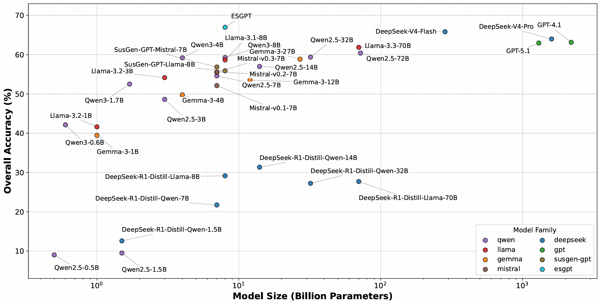

# ESGPT

[](PAPER_URL)
[](https://huggingface.co/nowzero/ESGPT)
[](https://huggingface.co/datasets/nowzero/ESGU-Bench)
[](LICENSE)

**ESGPT: A Data-Centric ESG Language Model with Unified Instruction and Benchmark Resources**

Official repository for our paper accepted at **EMNLP 2026 (Main Conference)**.

ESGPT provides unified resources for advancing and evaluating large language models in the Environmental, Social, and Governance (ESG) domain. The project introduces an ESG-specialized language model, an instruction-tuning dataset, and a comprehensive ESG understanding benchmark.

This repository provides links to the released resources and the official **ESGU-Bench evaluation code**.

## 📦 Resources

The following resources are available on Hugging Face:

| Resource | Description | Hugging Face |
|---|---|---|
| **ESGPT** | ESG-specialized language model based on Qwen3-8B. | [🤗 Model](https://huggingface.co/nowzero/ESGPT) |
| **ESG-Instruct** | 30K instruction examples covering 35 instruction tasks and general instruction data. | [🤗 Dataset](https://huggingface.co/datasets/nowzero/ESG-Instruct) |
| **ESGU-Bench** | 9,514 evaluation examples across 21 tasks and six ESG understanding areas. | [🤗 Dataset](https://huggingface.co/datasets/nowzero/ESGU-Bench) |

## 📊 Model Performance

The figure below compares the overall accuracy of different language models on ESGU-Bench with respect to model size.

**ESGPT achieves 66.96% overall accuracy**, demonstrating competitive ESG understanding capabilities with substantially fewer parameters than many larger models.



## 🚀 Quick Start

### Installation

Install the evaluation dependencies:

```bash
python -m pip install -r requirements.txt datasets torch
```

### Load ESGPT

ESGPT can be loaded directly from Hugging Face using the Transformers library.

```python
from transformers import AutoTokenizer, AutoModelForCausalLM

model_id = "nowzero/ESGPT"

tokenizer = AutoTokenizer.from_pretrained(model_id)

model = AutoModelForCausalLM.from_pretrained(
    model_id,
    torch_dtype="auto",
    device_map="auto"
)
```

### Load Datasets

The released datasets can be accessed using the Hugging Face Datasets library.

```python
from datasets import load_dataset

# ESG-Instruct
esg_instruct = load_dataset("nowzero/ESG-Instruct")

# ESGU-Bench
esgu_bench = load_dataset("nowzero/ESGU-Bench")
```

## 🧪 ESGU-Bench Evaluation

This repository provides the official ESGU-Bench scoring code. It does not load or run a model; generate predictions with any model and evaluate them using `evaluate.py`.

### Download Benchmark

```bash
hf download nowzero/ESGU-Bench esgu_bench.jsonl --repo-type dataset --local-dir .
```

### Prepare Predictions

Prepare one JSON object per line in `predictions.jsonl`:

```json
{"sample_id": "benchmark_full_00000000", "prediction": "model output"}
```

Each benchmark `sample_id` must appear exactly once.

### Run Evaluation

```bash
python evaluate.py \
  --benchmark-file esgu_bench.jsonl \
  --predictions-file predictions.jsonl \
  --output-dir evaluation_results
```

The output directory contains an evaluation summary and task- and category-level results.

Prompt construction, answer normalization, and task-specific scoring are implemented in `esgpt/` and remain unchanged from the experiment code.

This repository does not include training code, model weights, or dataset records.

## 📄 License

The resources are distributed under their respective licenses, subject to applicable third-party terms.

- **ESGPT:** See the [Hugging Face model repository](https://huggingface.co/nowzero/ESGPT).
- **ESG-Instruct:** See the [Hugging Face dataset repository](https://huggingface.co/datasets/nowzero/ESG-Instruct).
- **ESGU-Bench:** See the [Hugging Face dataset repository](https://huggingface.co/datasets/nowzero/ESGU-Bench).
- **Evaluation Code:** Apache License 2.0.

## 📝 Citation

If you use ESGPT, ESG-Instruct, ESGU-Bench, or the associated evaluation resources, please cite our paper:

```bibtex
@inproceedings{lee2026esgpt,
  title     = {{ESGPT}: A Data-Centric {ESG} Language Model with Unified Instruction and Benchmark Resources},
  author    = {Lee, Jaeyoung and Kim, Misuk},
  booktitle = {Proceedings of the 2026 Conference on Empirical Methods in Natural Language Processing},
  year      = {2026},
  publisher = {Association for Computational Linguistics}
}
```
